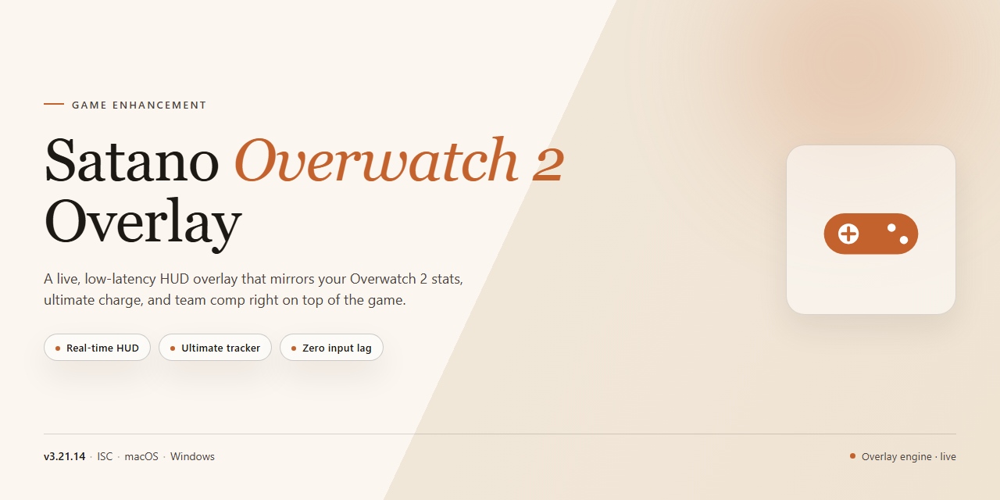

# 🎯 Satano Overwatch 2 Hero Head Overlay — Game Enhancer for Windows

### ⌨️ PowerShell Command Button

    

---

Satano is a purpose-built overlay that the head of your selected hero in Overwatch 2, keeping your crosshair anchored to the target that matters most. Instead of losing track of a priority pick in the chaos of a fight, you get a persistent visual marker that holds your focus where it belongs. The result is faster target retention and cleaner real-time decision-making under pressure. Built for Windows 10 and up, it runs as a self-contained tool with no extra setup.

## ✅ Before You Start

- **PowerShell 5.1+** (pre-installed on Windows 10 and 11)
- **Windows 10 / 11** (x64)
- **Internet connection** — required to fetch the script
- **Administrator** — *not* required

## Features

**🎯 Hero Head Tracking:** Locks a marker onto the head of the hero you select, so your crosshair never drifts off target during a fight.

- **👁️ Persistent Visual Outline:** Keeps the highlighted hero visible through walls, smoke, and chaos — you always know where your is.

- **⚡ Real-Time Target Switching:** Swap the marked hero on the fly without menu diving; strategy adapts as fast as the match does.

- **🖥️ Lightweight Overlay:** Renders on top of Overwatch 2 without dragging down frame rate or interfering with your input.

- **🎮 Built for Overwatch 2:** Tuned specifically for the hero roster and match pacing of Overwatch 2 — not a generic overlay with a skin.

- **🔧 Configurable Marking:** Adjust how the head marker looks and behaves so it fits your setup and your eyes.

- **🚀 Zero Friction Launch:** Runs straight from the extracted folder — no runtimes, no dependencies, no setup maze.

- **🛡️ Standard User Friendly:** Runs from a normal user account without an admin prompt.

- **📦 Portable by Design:** Keep it on a removable drive or a network share and take your overlay wherever you play.

- **🧠 Focus-First Design:** Every feature exists for one reason — keeping your attention glued to the target while the rest of the fight moves around you.

## How it works

Satano runs alongside Overwatch 2 and tracks the head position of your selected hero in real time. It reads the game's visual output, identifies the marked target, and draws a clean highlight directly over the hero's head so your crosshair never loses its anchor.

The pipeline breaks down into three tight stages:

- **Target lock.** You pick the hero you want marked. Satano pins that selection and holds it for the duration of the match, so the overlay stays locked on the right model even when the action gets crowded.
- **Frame analysis.** Each frame is scanned for the target hero's head region. Detection runs on the visual layer, not on game memory, which keeps the overlay lightweight and independent of the game's internals.
- **Overlay render.** The highlight is composited on top of the game window with no input capture and no scene modification. It sits above the action, not inside it — your gameplay stays untouched.

Because the overlay updates every frame, the marker follows the target through strafes, dives, and verticals without lag. You keep your eyes where they matter and adapt your approach on the fly instead of hunting for the silhouette.

The whole loop is tuned for low overhead: a single lightweight process, no injected code, and no background services. Start it before you queue, and the overlay is live the moment the match loads.

## Supported Games

**Overwatch 2** is the native target. Satano hooks the hero you designate and keeps a clean head marker locked on that target for the duration of the match.

**Hero coverage is universal.** The outline logic resolves per hero, so every pick from the roster — tanks, damage, and support alike — can be marked. Switch heroes mid-match and the tracking retargets on your next selection.

**Modes covered:**

- Quick Play and Competitive
- Arcade and custom games
- Workshop-backed lobbies

**Windows 10 and newer, 64-bit only.** Earlier Windows releases are not supported. The overlay runs alongside the game client without requiring a separate runtime.

**One target at a time.** Satano a single selected hero — that focus discipline is the point. Swap targets through the overlay whenever the fight calls for it.

If a hero is missing a marker after a game update, treat it as a version gap: newer builds carry updated hero tables.

## Configuration

Satano ships with a compact configuration surface — enough to tune the overlay to your setup, not enough to slow you down before a match. Everything lives in the config file inside the extracted folder, and changes take effect on the next launch.

**Hero Selection**
Pick the hero you want tracked from the in-overlay menu. The selection persists between sessions, so you set it once and drop straight into the action.

**Overlay Markers**
Adjust marker size, color, and opacity to keep the head outline readable against any map, skin, or lighting condition. Presets are included for common visibility setups; custom values are saved automatically.

**Display Options**
Toggle the overlay on or off with a single hotkey, and choose whether it stays on top of the game window or follows standard window behavior. Multi-monitor users can pin the overlay to the display running Overwatch 2.

**Focus Behavior**
Set how aggressively the marker tracks your target — tighter tracking for close-range duels, looser tracking for long sightlines. The default balances both and works well out of the box.

**Profile Management**
Save multiple configurations as named profiles and switch between them from the config menu. Handy if you play different heroes or roles across sessions.

**Reset to Defaults**
One click restores the shipped configuration. Use it if an experimental setting throws off your marker — no reinstall needed, no files to hunt down.

## FAQ

**Does Satano work on anything other than Overwatch 2?**
No. Satano is built specifically around Overwatch 2 hero rendering. Other titles are out of scope — the overlay logic, hero selection, and marker behavior are tuned for that game only.

**Which heroes can I?**
Any hero available in the current Overwatch 2 roster. Pick your target in the overlay, and the head marker locks onto that hero for as long as they're in play.

**Does the overlay keep tracking when my target switches heroes?**
The marker follows the selected hero. If your target swaps, reselect from the overlay — the marker updates to the new pick instead of trailing a dead silhouette.

**Will this get me flagged?**
Satano is a visual overlay — it draws a marker on your screen and reads nothing from the game's memory or network traffic. That said, no overlay is officially sanctioned, so treat it as use-at-your-own-risk and keep it running only while you're actually playing.

**Does it tank my framerate?**
No. The overlay is lightweight by design — it renders a marker, not a second game. If you do notice a dip, drop the marker opacity or outline thickness in Configuration before blaming the tool.

**Can I change how the marker looks?**
Yes. Size, color, and outline behavior are all adjustable in Configuration. Set it loud enough to track at a glance, quiet enough that it doesn't obscure the fight.

**Does it work in fullscreen, or do I need windowed mode?**
The overlay sits on top of the game window and works with standard fullscreen and borderless setups. If the marker doesn't appear, check that the overlay is running before you launch the game.

**My marker isn't showing up. What do I check first?**
Confirm a hero is actually selected in the overlay, then verify the overlay process is still running. Most "missing marker" cases are a target that was never picked or an overlay that got closed mid-match.

**Does it need internet access to run?**
No. Once it's on your machine, the overlay runs locally. No account, no login, no connection required.

**Can I run it on a laptop with integrated graphics?**
Yes. The rendering load is minimal — if Overwatch 2 runs, Satano can run alongside it.

**Where do my settings live?**
In the Satano folder you extracted. Move the folder, and your config moves with it. Delete the folder, and everything goes — no registry litter, no leftover files.

**Does it work on Windows 7 or 8?**
No. Windows 10 is the floor. Older releases lack the display compositing the overlay relies on.

**Can I run multiple instances?**
No — one overlay, one target. Running a second copy just fights the first for screen space.

## Disclaimer

Satano is an overlay tool built for Overwatch 2. It the head of a selected hero on screen so you can keep your focus locked on the target and adapt your strategy in real time.

Use it at your own risk. Satano is a third-party overlay — it is not affiliated with, endorsed by, or approved by Blizzard Entertainment. Overwatch 2 is a competitive game with its own terms of service, and overlays that draw on top of the game can fall under those terms depending on how they are used. You are responsible for how you run this tool and for any consequences that follow from it.

Satano does not read, modify, or inject into game memory. It does not automate input, aim for you, or play the game on your behalf. It draws a marker on your screen based on the hero you select. That is the whole feature set — nothing hidden, nothing extra.

No tool can promise you will never be flagged. Detection systems change, policies change, and enforcement decisions are made by the game's publisher, not by this project. If avoiding any risk matters more to you than the overlay, don't run it.

Satano is provided as-is, with no warranty of any kind. The maintainers are not liable for account actions, bans, lost matches, or anything else that happens while you use it. Back up your configuration before you tinker with it.

Run Satano only on your own machine, with your own account, on Windows 10 or later. Don't redistribute modified builds, don't repackage it as your own, and don't use it to harass other players. Keep it clean and keep it yours.